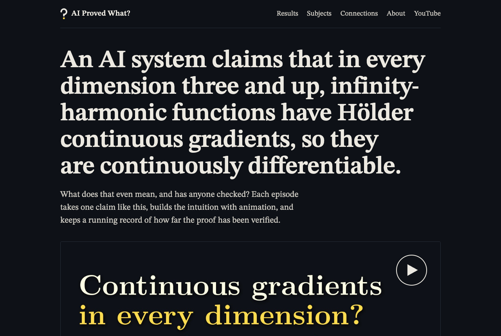
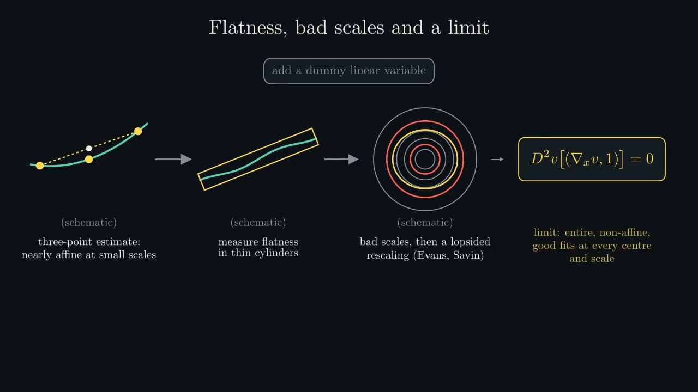
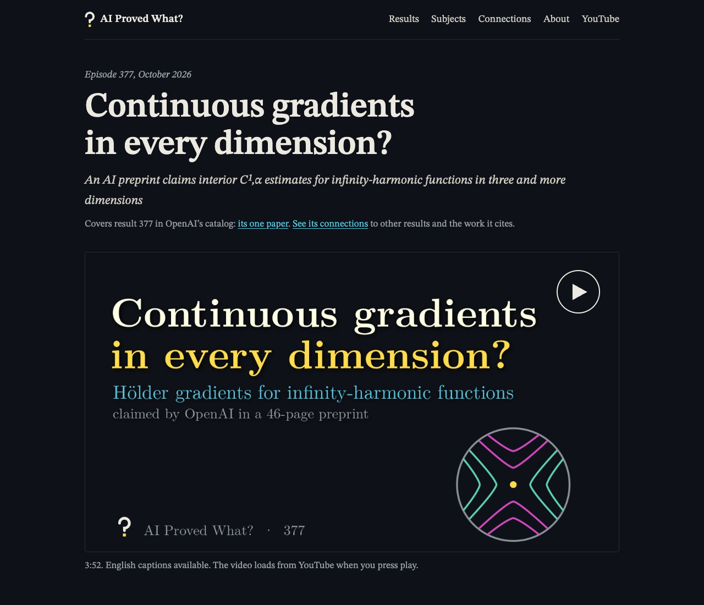
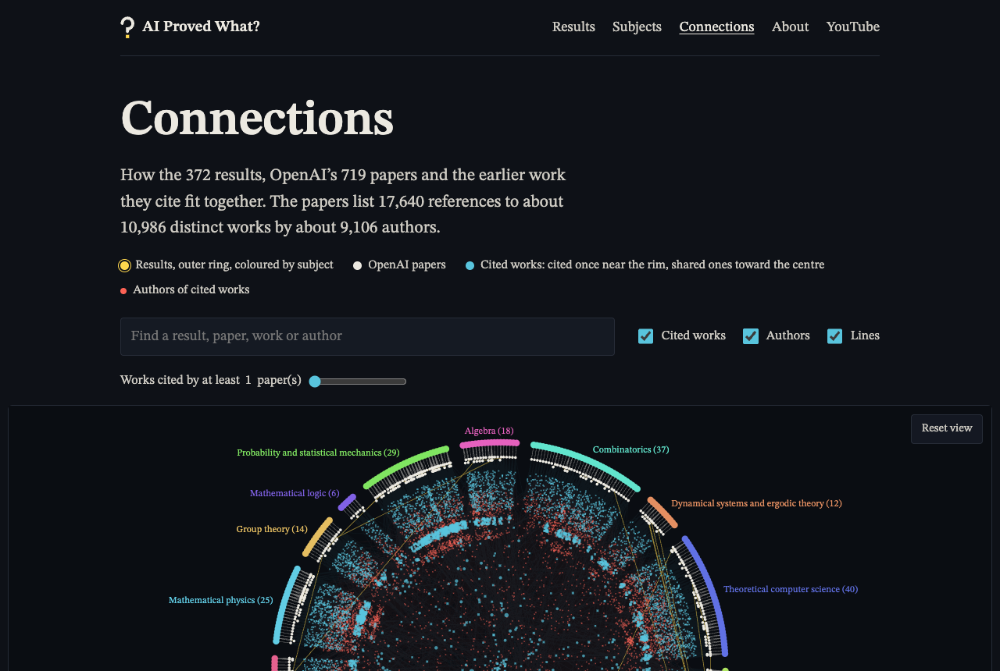

# AI Proved What?

New AI mathematics, explained and checked.

This repository holds the website at **aiprovedwhat.com**. Each episode explains
one mathematical result that an AI system claims to have proved, and keeps a
record of how far the proof has been checked. The videos live on the
[AI Proved What? YouTube channel](https://www.youtube.com/@AIProvedWhat).

It covers every result in OpenAI's math catalogue (373 results in 721 papers as of
October 27, 2026; the site's `docs/data/results.json` has the current figures), and,
under **Beyond OpenAI's catalogue**, one-off OpenAI announcements and results from
other labs: Axiom Math, PSI and Anthropic.

## What it looks like



Each episode is a short, picture-first animation: one diagram per idea, built up
step by step, with the exact claim on screen and every illustrative picture
labelled "(schematic)".



| An episode page | How the results connect |
|---|---|
|  |  |

Every episode page also keeps a running four-step record of where the claim
stands: posted as a preprint, under expert review (a named independent group such
as OSVerify), peer reviewed, and checked in Lean, with the date it was last checked.
Screenshots live in `docs/assets/readme/`.

## What's committed, and what stays local

Only the website (`docs/`), this README and the license files are committed.
Everything else in the project folder stays on the computer that made it, and
`.gitignore` blocks it from being committed by accident:

```
docs/        the website: committed and published
episodes/    per-episode script, captions, YouTube kit, animation code (local)
media/       videos, narration audio, voice model files (local)
brand/       channel artwork and the script that draws it (local)
tools/       narration, alignment and caption scripts (local)
```

Because those folders aren't on GitHub, back them up some other way.

## Preview the website

```
cd docs
python3 -m http.server 8000
```

Then open http://localhost:8000.

## Publish with GitHub Pages and Cloudflare

1. In the GitHub repo, go to **Settings → Pages**. Under "Build and deployment",
   choose **Deploy from a branch**, branch `main`, folder **`/docs`**, and save.
2. On the same page, enter `aiprovedwhat.com` under **Custom domain** and save.
   (`docs/CNAME` already contains it.)
3. In Cloudflare DNS for aiprovedwhat.com, add these records, all set to
   **DNS only** (grey cloud) so GitHub can issue the HTTPS certificate:
   - four `A` records for `@`: `185.199.108.153`, `185.199.109.153`,
     `185.199.110.153`, `185.199.111.153`
   - one `CNAME` record for `www` pointing to `nathannam.github.io`
4. Once the certificate is ready, tick **Enforce HTTPS** in Settings → Pages.
5. Verify the domain under your GitHub account's **Settings → Pages**, so no one
   else can claim it.

## Making an episode

Each episode has a folder in `episodes/` with a `script/narration.py` that
holds the narration, spelling fixes and chapter list. From the project folder:

1. `python3 tools/narrate.py episodes/<episode>` makes the narration clips.
2. Animate with Manim, timing each scene to those clips (see
   `episodes/001-milne-rationality/animation/common.py` for the house style).
   Save the finished video as `media/<episode>.mp4`.
3. `python3 tools/align.py episodes/<episode>` finds each line in the video.
4. `python3 tools/captions.py episodes/<episode>` writes the captions.
5. Make a thumbnail, fill in `youtube/title.txt` and `youtube/description.txt`,
   and upload.
6. Copy `docs/episodes/001-milne-rationality/` for the episode page (into the
   result's existing folder, replacing its "Episode coming" page), update it,
   add the episode to `tools/site/episodes.json`, and run
   `python3 tools/site/build.py`. See `tools/site/README.md`.
7. Before publishing, re-check the record against the source: preprint date,
   peer review, Lean formalization and withdrawals.

Install the Python packages with `pip install -r tools/requirements.txt`.

## Licenses

- Site code: MIT, see `LICENSE`.
- Scripts, captions, images and page text: CC BY 4.0, see `LICENSE-CONTENT.md`.
- Source papers and tools: see `NOTICE.md`.

AI Proved What? is independent and not affiliated with OpenAI or any other
organization whose work it covers. It is made with Claude, Anthropic's AI;
Anthropic's own results (AN) are held to the same standards as every other lab's,
using only public sources.
